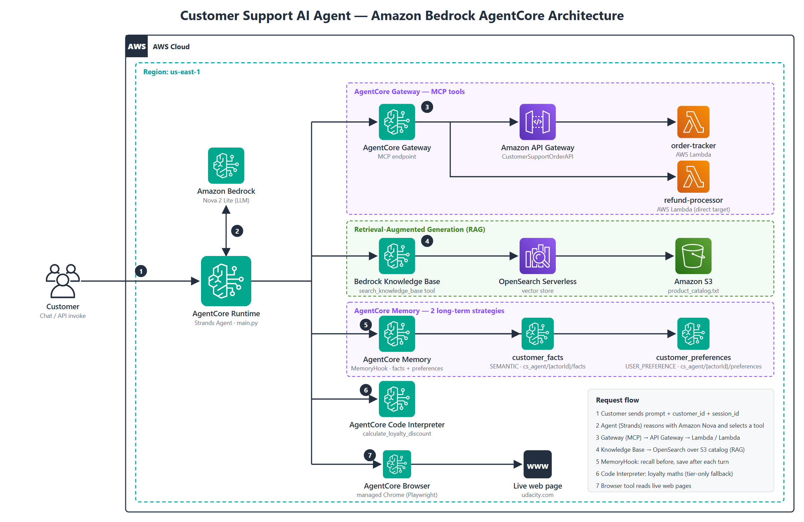

# Customer Support AI Agent on Amazon Bedrock AgentCore

An AI customer support agent that can **track orders, process refunds, answer policy questions, remember customers across conversations, calculate loyalty discounts, and read live web pages**. It is built with **Amazon Bedrock AgentCore** and the **Strands Agents SDK**, and runs as a deployed cloud service on AWS.

> Built as part of the *Future AWS Agent Engineer* Nanodegree (Udacity). All six end-to-end tests ran against the **deployed** agent, and the screenshots are in this repo.



---

## What it does

A customer sends a message such as *"Can you track order ORD-001?"*. The agent decides which tool it needs, calls it, and replies in plain language.

| Customer asks... | What the agent does | AWS services behind it |
|---|---|---|
| "Track order ORD-001" | Looks up status, carrier and tracking number | AgentCore Gateway (MCP) → API Gateway → Lambda |
| "I want to return my Kindle (ORD-002)" | Approves the refund and returns a confirmation ID | AgentCore Gateway (MCP) → Lambda |
| "What are the benefits of Platinum tier?" | Retrieves the answer from the product and policy catalog (RAG) | Bedrock Knowledge Base, OpenSearch Serverless, S3 |
| "Hi, I'm Jane, I prefer concise replies" … *new session later* … "Do you remember me?" | Recalls her name and preference in a **different** session | AgentCore Memory (2 strategies) |
| "I'm Gold with 4,250 points, discount on a $150 order?" | Calculates the exact total with code, not LLM guesswork | AgentCore Code Interpreter |
| "Go to udacity.com and tell me the page title" | Opens the page and reads it | AgentCore Browser |

---

## How it works

1. The customer's message reaches the agent running on **AgentCore Runtime** (`main.py`).
2. The agent reasons with **Amazon Nova** and picks a tool.
3. **Gateway tools (MCP):** order tracking goes through API Gateway to a Lambda, and refunds go to a Lambda directly. If the Gateway fails, the error is logged and the customer gets a safe, clear message instead of a crash.
4. **Knowledge Base (RAG):** policy and product questions are answered from a catalog stored in S3 and indexed in OpenSearch Serverless.
5. **Memory:** before each reply a `MemoryHook` retrieves relevant past facts and preferences, and after each reply it saves the new turn. There are two long-term strategies:
   - `customer_facts` (SEMANTIC)
   - `customer_preferences` (USER_PREFERENCE)
6. **Code Interpreter:** loyalty maths (points redemption in multiples of 500, tier discount, final total, remaining points) runs in an isolated Python sandbox. If the sandbox is unavailable, a **tier-only discount fallback** is returned.
7. **Browser:** a managed headless Chrome reads live web pages.

### Why these design choices
- **Code, not the LLM, does the maths.** LLMs are unreliable at multi-step arithmetic, so the agent is required to call the Code Interpreter tool.
- **Memory is separate from the chat session.** That is how the agent can remember a customer in a brand-new session.
- **Failures are expected.** Gateway and Code Interpreter errors are handled so the customer always gets an answer.

---

## Demo results

| Test | Result |
|---|---|
| 1. Order tracking | `ORD-001` is `SHIPPED`, UPS, tracking `TRK987654321` |
| 2. Refund | `ORD-002` approved, `$139.99`, refund ID `REF-BSSB2QTJ` |
| 3. Knowledge Base (RAG) | Platinum: free same-day shipping, 15% discount, priority support |
| 4. Memory (two sessions) | Session B recalled Jane's name and preference from Session A |
| 5. Loyalty discount | Final total `$99.00`, 349 points remaining |
| 6. Browser | Returned the live page title of udacity.com |

Memory recall across two sessions (Test 4):

| Session A: information shared | Session B: recalled from memory |
|---|---|
|  |  |

All screenshots, prompts and outcomes are in [`docs/project_screenshots/README.md`](docs/project_screenshots/README.md).

---

## Biggest challenge: a Windows zip broke the browser tool

The browser tool worked locally but failed in the cloud, and the agent reported a vague "permission error". IAM was correct, so I read the CloudWatch logs and found the real error:

```
Permission denied: /var/task/playwright/driver/node
```

The deployment zip is built on Windows, and Windows zips don't keep Linux executable permissions. The fix is a small startup step in `main.py` (`_fix_playwright_node`) that copies the Node binary to `/tmp`, makes it executable, and points Playwright at it with `PLAYWRIGHT_NODEJS_PATH`.

**Lesson:** read the logs before trusting the model's explanation of an error. More troubleshooting notes are in [`docs/challenges_faced.md`](docs/challenges_faced.md), and my full reflection is in [`Reflections.md`](Reflections.md).

---

## Tech stack

Amazon Bedrock AgentCore (Runtime, Gateway, Memory, Code Interpreter, Browser) · Strands Agents SDK · Amazon Nova · Amazon Bedrock Knowledge Bases · OpenSearch Serverless · AWS Lambda · Amazon API Gateway · Amazon S3 · IAM · CloudWatch · Python 3.13 · uv

---

## Environment

Everything runs in **`us-east-1`** on a Udacity sandbox AWS account.

| Resource | Details |
|----------|---------|
| **Lambda: order-tracker** | `arn:aws:lambda:us-east-1:057616154556:function:order-tracker` |
| **Lambda: refund-processor** | `arn:aws:lambda:us-east-1:057616154556:function:refund-processor` |
| **API Gateway** | `CustomerSupportOrderAPI` (ID: `jnq74xt861`, Stage: `prod`) |
| **AgentCore Gateway** | `CustomerSupportGateway` (`customersupportgateway-yfa07mmavr`) |
| **Gateway URL** | `https://customersupportgateway-yfa07mmavr.gateway.bedrock-agentcore.us-east-1.amazonaws.com/mcp` |
| **Knowledge Base** | `CustomerSupportKB` (ID: `CQ0I5EWR3A`, synced with `product_catalog.txt`) |
| **AgentCore Memory** | `CustomerSupportMemory` (ID: `CustomerSupportMemory-E2T0yi7ZzC`) |
| **Foundation Model** | Amazon Nova 2 Lite (`global.amazon.nova-2-lite-v1:0`) |
| **AgentCore Runtime** | `customer_support_agent-zf9262EdhB` |

Console screenshots of the provisioned resources are in [`docs/environment_screenshots/README.md`](docs/environment_screenshots/README.md).

---

## Project structure

```
.
├── main.py                      # Agent: Strands + AgentCore app, memory hook, tools
├── Reflections.md               # Written reflection (design, challenge, production)
├── .bedrock_agentcore.yaml      # AgentCore deployment configuration
├── setup_permissions.py         # IAM permission configuration for the deployed agent
├── product_catalog.txt          # Product catalog ingested by the Knowledge Base
├── pyproject.toml / uv.lock     # Dependencies
├── src/ai_support_agent/        # Local package root (for uv packaging)
├── lambda/
│   ├── order_tracker.py         # Order tracking Lambda (behind API Gateway)
│   ├── refund_processor.py      # Refund processing Lambda (direct Gateway target)
│   └── lambda_schema            # JSON schema for refund tools
└── docs/
    ├── architecture_diagram.png # Architecture diagram
    ├── step_by_step_guide.md    # Infrastructure and deployment log
    ├── challenges_faced.md      # Troubleshooting notes
    ├── project_screenshots/     # Tests 1–6 and deployment screenshots
    └── environment_screenshots/ # AWS console screenshots
```

---

## Run it yourself

```bash
# 1. Install dependencies
uv sync --python 3.13

# 2. Add AWS credentials to .env (sandbox account, us-east-1)
#    AWS_ACCESS_KEY_ID=...  AWS_SECRET_ACCESS_KEY=...  AWS_SESSION_TOKEN=...  AWS_DEFAULT_REGION=us-east-1

# 3. Configure and deploy to AgentCore
uv run agentcore configure --entrypoint main.py --name customer_support_agent \
  --deployment-type direct_code_deploy --runtime PYTHON_3_13 --disable-memory
uv run agentcore deploy

# 4. Talk to the deployed agent
uv run agentcore invoke '{"prompt": "Can you track order ORD-001?", "customer_id": "CUST-123", "session_id": "s1"}'
```

`--disable-memory` only stops the toolkit from creating its own memory; the agent uses the `CustomerSupportMemory` resource created during setup. The full setup log is in [`docs/step_by_step_guide.md`](docs/step_by_step_guide.md).

---

## What I'd add for production

- Build and deploy from CI on Linux, so packaging problems like the one above disappear.
- Add Bedrock Guardrails and require human approval for large refunds (the refund tool currently approves any request the model makes).
- Add CloudWatch alarms on Gateway tool errors and latency, plus automated tests that replay Tests 1–6 after every change.
- Cache common knowledge-base answers and add per-customer rate limits to control cost.

---

## Rubric deliverables (for reviewers)

| Deliverable | Location |
|-------------------|-------------------|
| **Completed Agent Code** | [`main.py`](main.py) |
| **Written Reflection (200–400 words)** | [`Reflections.md`](Reflections.md) |
| **Test 1 — Order Tracking** | [`docs/project_screenshots/README.md#test-1--order-tracking`](docs/project_screenshots/README.md#test-1--order-tracking) |
| **Test 2 — Refund Processing** | [`docs/project_screenshots/README.md#test-2--refund-processing`](docs/project_screenshots/README.md#test-2--refund-processing) |
| **Test 3 — Knowledge Base (RAG)** | [`docs/project_screenshots/README.md#test-3--knowledge-base-rag`](docs/project_screenshots/README.md#test-3--knowledge-base-rag) |
| **Test 4 — Long-Term Memory** | [`docs/project_screenshots/README.md#test-4--long-term-memory-two-sessions`](docs/project_screenshots/README.md#test-4--long-term-memory-two-sessions) |
| **Test 5 — Loyalty Discount** | [`docs/project_screenshots/README.md#test-5--loyalty-discount-calculation`](docs/project_screenshots/README.md#test-5--loyalty-discount-calculation) |
| **Test 6 — Browser Tool** | [`docs/project_screenshots/README.md#test-6--browser-tool`](docs/project_screenshots/README.md#test-6--browser-tool) |
| **AgentCore deployment** | [`docs/project_screenshots/README.md#agentcore-cloud-deployment-success`](docs/project_screenshots/README.md#agentcore-cloud-deployment-success) |
| **Environment setup** | [`docs/environment_screenshots/README.md`](docs/environment_screenshots/README.md) |
| **Challenges** | [`docs/challenges_faced.md`](docs/challenges_faced.md) |
