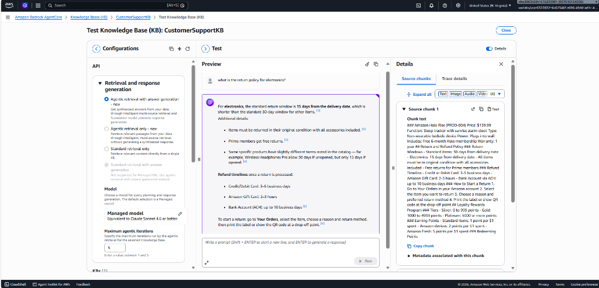
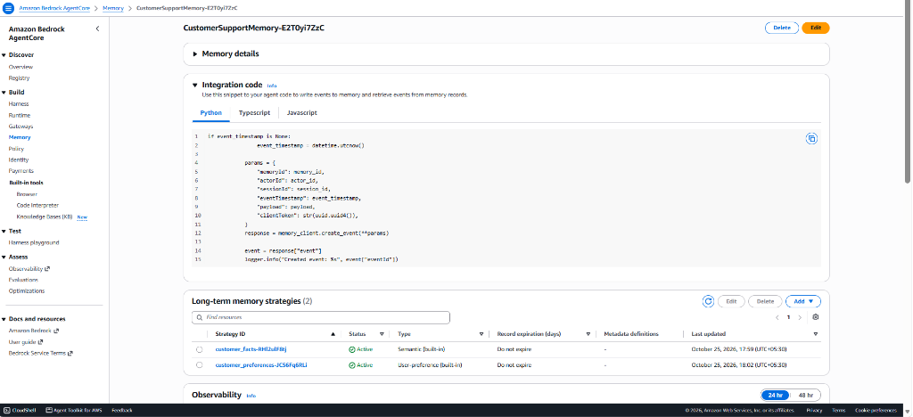
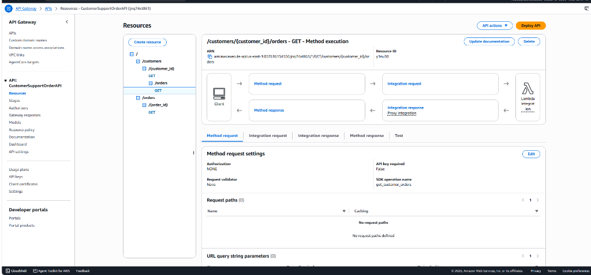

# Customer Support AI Agent — Amazon Bedrock AgentCore

Building a production-grade AI customer support agent using **Amazon Bedrock AgentCore** and the **Strands SDK**.

The agent serves as an intelligent interface between customers and an e-commerce platform that handles multi-turn conversations while maintaining context across sessions:
- Order tracking
- Returns processing
- Product recommendations
- Loyalty rewards calculations

---

## Infrastructure & Environment Setup

All prerequisite AWS infrastructure has been provisioned and configured in **`us-east-1`** using the provided Udacity sandbox account:

| Resource | Details |
|----------|---------|
| **Region** | `us-east-1` (N. Virginia) |
| **AWS Account** | `057616154556` (Udacity Sandbox) |
| **Lambda — order-tracker** | `arn:aws:lambda:us-east-1:057616154556:function:order-tracker` |
| **Lambda — refund-processor** | `arn:aws:lambda:us-east-1:057616154556:function:refund-processor` |
| **API Gateway** | `CustomerSupportOrderAPI` (ID: `jnq74xt861`, Stage: `prod`) |
| **AgentCore Gateway** | `CustomerSupportGateway` (`customersupportgateway-yfa07mmavr`) |
| **Gateway URL** | `https://customersupportgateway-yfa07mmavr.gateway.bedrock-agentcore.us-east-1.amazonaws.com/mcp` |
| **Knowledge Base** | `CustomerSupportKB` (ID: `CQ0I5EWR3A`, Synced with `product_catalog.txt`) |
| **AgentCore Memory** | `CustomerSupportMemory` (ID: `CustomerSupportMemory-E2T0yi7ZzC`, Active) |
| **Foundation Model** | Amazon Nova Lite (`global.amazon.nova-2-lite-v1:0`) |

---

## Project Structure

```
.
├── main.py                      # Core agent implementation (starter template with Step 8 config filled)
├── .bedrock_agentcore.yaml      # AgentCore deployment configuration (generated by agentcore configure)
├── setup_permissions.py         # Permission configuration script
├── product_catalog.txt          # Product catalog for Knowledge Base
├── pyproject.toml               # Project dependencies manifest
├── uv.lock                      # Pinned dependencies lockfile
├── lambda/
│   ├── order_tracker.py         # Order tracking Lambda (REST API proxy)
│   ├── refund_processor.py      # Refund processing Lambda (direct MCP tool)
│   └── lambda_schema            # JSON schema for refund tools
└── docs/
    └── step_by_step_guide.md    # Infrastructure deployment log
```

---

## Local Setup

### 1. Install Dependencies
Using `uv`:
```bash
uv sync --python 3.13
```

### 2. Configure AWS Credentials
Ensure credentials from your Udacity sandbox account are configured in your local environment or `.env`:
```bash
AWS_ACCESS_KEY_ID=...
AWS_SECRET_ACCESS_KEY=...
AWS_SESSION_TOKEN=...
AWS_DEFAULT_REGION=us-east-1
```

### 3. Verify Setup
Check AWS caller identity:
```bash
aws sts get-caller-identity
```

### 4. Configure AgentCore Deployment
Generate the `.bedrock_agentcore.yaml` deployment configuration:
```bash
uv run agentcore configure \
  --entrypoint main.py \
  --name customer_support_agent \
  --deployment-type direct_code_deploy \
  --runtime PYTHON_3_13 \
  --disable-memory
```
This creates `.bedrock_agentcore.yaml`, which identifies your agent's entrypoint and deployment settings.
Let the toolkit create the runtime execution role when prompted.

> **Note:** The `--disable-memory` option disables only automatic memory creation. Your agent uses the memory resource you created during setup (`CustomerSupportMemory`).

---

## Environment Setup Screenshots

The following screenshots document the deployed and verified prerequisite infrastructure in the Udacity sandbox AWS account:

### 1. Bedrock AgentCore Gateway (Targets Ready)


### 2. Bedrock Knowledge Base Overview


### 3. Knowledge Base RAG Query Verification


### 4. Bedrock AgentCore Memory Strategies


### 5. Lambda Functions (Order Tracker & Refund Processor)


### 6. API Gateway (REST API & Proxy Routes)

