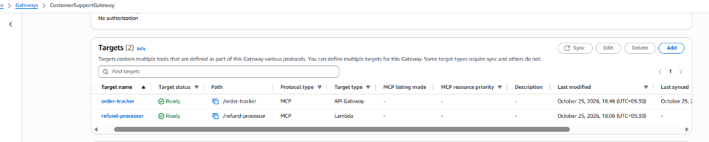
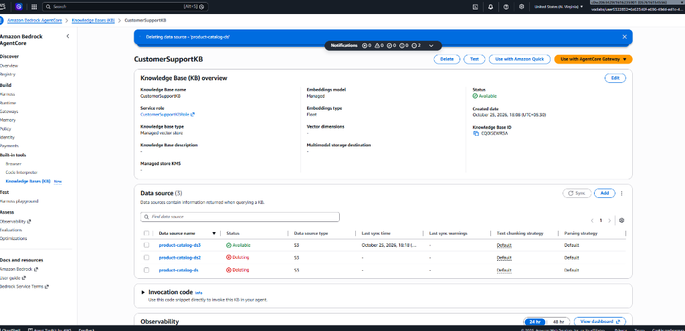
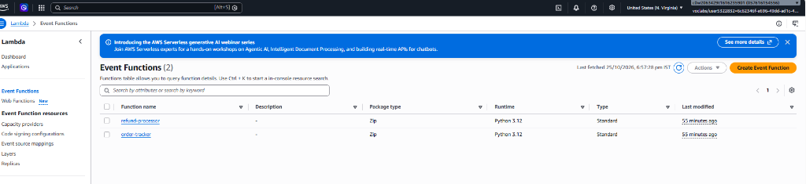

# Environment Setup Screenshots

This directory contains visual confirmation screenshots of the deployed and verified infrastructure resources within the AWS sandbox account (`us-east-1`):

---

### 1. Bedrock AgentCore Gateway (Targets Ready)
Shows `CustomerSupportGateway` with active MCP tools routing to the Lambda functions and API Gateway.

---

### 2. Bedrock Knowledge Base Overview
Overview of `CustomerSupportKB` connected to OpenSearch Serverless and indexed with `product_catalog.txt`.

---

### 3. Knowledge Base RAG Query Verification
Live query test in the Bedrock console validating retrieval augmented generation against the product catalog.

---

### 4. Bedrock AgentCore Memory Strategies
Configuration of `CustomerSupportMemory` showing session summary and semantic extraction strategies.

---

### 5. Lambda Functions (Order Tracker & Refund Processor)
Deployed Lambda functions for order tracking and refund processing.

---

### 6. API Gateway (REST API & Proxy Routes)
Deployed `CustomerSupportOrderAPI` with REST resources and `prod` stage deployment.

