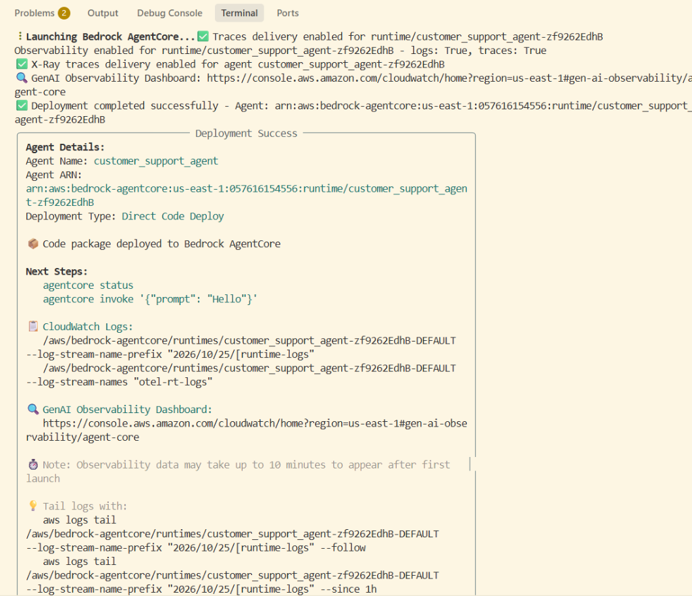
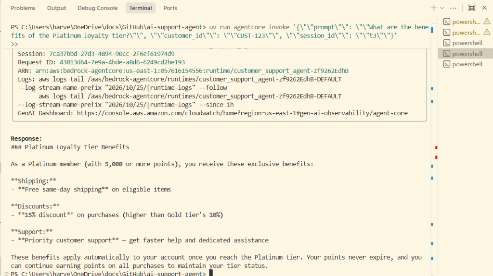

# Project Verification Screenshots

Here are screenshots of the agent deployment, functional query execution, tool usage, memory retention, and browser testing.

---

### 1. Bedrock AgentCore Deployment Success
Visual confirmation of successful packaging, S3 staging, IAM role binding, and runtime deployment to Amazon Bedrock AgentCore (`customer_support_agent-zf9262EdhB`).

---

### 2. Test 1 — Order Tracking
Validation of tool calling via AgentCore Gateway and the `order-tracker` Lambda function:
- **Prompt**: `"Can you track order ORD-001?"`
- **Customer ID**: `CUST-123`
- **Outcome**: The agent retrieved order status (`SHIPPED`), item details (`Wireless Headphones Pro`, `$89.99`), carrier (`UPS`), tracking number (`TRK987654321`), and estimated delivery date.

---

### 3. Test 2 — Refund Processing
Validation of refund initiation via AgentCore Gateway and the `refund-processor` Lambda tool:
- **Prompt**: `"I want to return my Kindle Paperwhite (ORD-002). Please initiate a refund."`
- **Customer ID**: `CUST-123`
- **Outcome**: The agent successfully processed the return for `ORD-002`, approved a refund of `$139.99` back to the customer's payment method, generated refund confirmation ID `REF-BSSB2QTJ`, and offered a prepaid return shipping label.

---

### 4. Test 3 — Knowledge Base (RAG)
Validation of RAG search using the `search_knowledge_base` tool connected to Amazon Bedrock Knowledge Base:
- **Prompt**: `"What are the benefits of the Platinum loyalty tier?"`
- **Customer ID**: `CUST-123`
- **Outcome**: The agent retrieved exact policy definitions from `product_catalog.txt` via OpenSearch Serverless:
  - **Free same-day shipping** on eligible items
  - **15% discount** on purchases (compared to 10% for Gold)
  - **Priority customer support** with dedicated assistance
  - Tier threshold: 5,000+ points

